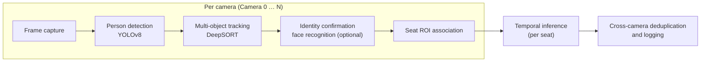

# Multi-Camera Seat-Level Occupancy Detection for Smart Buildings

Final Year Project, College of Computing and Data Science, Nanyang Technological University (2026).

**Author:** Usama Bin Ali Bafana · **Supervisor:** Dr Tan Wen Jun

This repository contains the code for a vision-based system that reports, for each seat in an office, whether it is
occupied or vacant, using several ordinary cameras whose views may overlap. The design, experiments and results are
described in the final report; the section numbers below refer to that report.

---

## How it works

Each camera runs the same per-frame pipeline. The per-seat results of all cameras are then combined, so that a desk
seen by two cameras is counted once.



| Stage | Module | Report |
|---|---|---|
| Person detection (YOLOv8; custom fine-tuned `best_v4.pt` or COCO-pretrained `yolov8n.pt`) | `src/detector.py` | 4.2, 5.2 |
| Multi-object tracking (DeepSORT, MobileNet appearance embedder) | `src/tracker.py` | 4.3 |
| Face recognition (DeepFace, VGG-Face, MTCNN detector, auto-enrolment) | `src/face_recognition_module.py` | 4.4 |
| Seat regions of interest and person-to-seat matching | `src/seat_manager.py` | 4.5 |
| Temporal inference (rolling window, threshold, cooldown) | `src/temporal_inference.py` | 4.6 |
| Multi-camera pipeline and cross-camera deduplication | `src/multi_pipeline.py` | 4.7 |
| Homography seat matching / opportunistic calibration | `scripts/calibrate_homography.py`, `scripts/auto_match_seats_homography.py`, `src/opportunistic_calibration.py` | 4.7 |
| Evaluation against ground truth | `evaluate/metrics.py` | 5.3, 5.8 |
| Computation-cost benchmark | `scripts/benchmark.py`, `src/accel.py`, `src/resource_monitor.py` | 5.9 |

## Key results

| Experiment | Result |
|---|---|
| Proof-of-concept test (3 seats, 2 cameras, 3 participants, 2.6 min) | F1 score 80.2% over all seat-seconds; 88.1% excluding the 5 s after each real change (Table 12) |
| Detector fine-tuning (`best_v4.pt`, validation split) | mAP50 0.984, mAP50-95 0.810, precision 0.958, recall 0.955 (Table 8) |
| Capacity of the test laptop (Intel Core i7-1260P, CPU only) | about 4 cameras without face recognition, 1 with it (Table 14) |
| Same laptop with its integrated GPU (OpenVINO) | up to 6 cameras without face recognition, 2 with it (Table 14) |

The saved outputs behind these figures are in [`results/`](results/README.md), and the PoC figures can be recomputed
with one command (see [Evaluate against ground truth](#6-evaluate-against-ground-truth)).

## Repository structure

```
.
├── main.py                  # single-camera entry point: run | train | enrol | evaluate | visualise
├── run_dual.py              # multi-camera entry point (used for the PoC test)
├── config/
│   ├── settings.yaml        # all tunable parameters (values used for the final PoC run)
│   └── config_loader.py
├── src/                     # pipeline modules (see table above)
├── evaluate/metrics.py      # occupancy metrics and ground-truth matching
├── scripts/                 # set-up, calibration, labelling and benchmarking tools (listed below)
├── tests/                   # unit tests (pytest)
├── results/                 # saved outputs behind the report's tables
├── models/                  # model weights (see models/README.md)
├── notebooks/               # exploratory Colab notebooks (not part of the reported results)
└── requirements.txt
```

### Scripts

All scripts are run from the project root, e.g. `python scripts/preflight.py`. Each has a `--help` option and a usage
description at the top of the file.

| Purpose | Script | What it does |
|---|---|---|
| **Set-up** | `preflight.py` | One-command check before a session: packages, model weights, tracker, cameras (saves a snapshot of each), seat files, disk space. |
| | `identify_cameras.py` | Saves one snapshot per camera index, side by side, to confirm which physical camera is index 0 / 1. |
| | `list_cameras.py` | Prints camera index → device name on Windows (needs `pygrabber`). |
| | `setup_and_run.py` | Chains camera check → seat auto-detection → click-to-pair → `run_dual.py` in one command. |
| **Seats** | `test_autodetect.py` | Proposes seat boxes from chairs detected in an empty scene (COCO YOLOv8) and saves them for review. |
| | `save_seat_preview.py` | Saves a screenshot of a camera with its saved seat boxes drawn on it. |
| | `chair_bbox_margin.py` | Measures how much chair boxes move between sessions, to justify the matching tolerances. |
| **Cross-camera pairing** | `map_shared_seat.py` | Click-to-pair tool: link the same physical desk in two camera views; writes `config/shared_seats.yaml`. |
| | `calibrate_homography.py` | Click ≥ 4 matching floor points in both views and estimate the camera-to-camera homography. |
| | `auto_match_seats_homography.py` | Pairs seats automatically by projecting them through the homography; writes `config/shared_seats.yaml`. |
| | `sweep_homography_params.py` | Compares RANSAC / LMedS / least-squares settings on the clicked points. |
| | `preview_shared_seats.py` | Shows both cameras with the current pairing drawn, as a visual check. |
| **Ground truth** | `record_clips.py` | Records several cameras at once to MP4 for repeatable offline runs. |
| | `record_ground_truth.py` | Logs the true seat state by key press during a live session. |
| | `label_ground_truth.py` | Frame-accurate labelling of a recorded clip (used for the PoC evaluation). |
| **Computation cost** | `benchmark.py` | Times each pipeline stage and projects how many cameras one machine can serve. |
| | `validate_cost_model.py` | Compares the benchmark's prediction with a live run logged by `run_dual.py --log-resources`. |

## Installation

Tested with **Python 3.12 on Windows 11**, CPU only. Camera capture uses the Windows DirectShow backend; video files
work on any platform.

```powershell
git clone <repository-url>
cd <repository-folder>
python -m venv .venv
.venv\Scripts\activate            # macOS / Linux: source .venv/bin/activate
pip install -r requirements.txt
```

Optional extras: `pip install openvino` (Intel integrated-GPU benchmark), `pip install pygrabber`
(`scripts/list_cameras.py`), `pip install pytest` (tests).

The COCO-pretrained `yolov8n.pt` is downloaded automatically on first use. The custom detector is in
`models/best_v4.pt` (see [`models/README.md`](models/README.md)).

## Usage

### 1. Check the set-up

```powershell
python scripts/preflight.py --cams 0 1
```

### 2. Define the seats for each camera

Seats are saved per camera as `output/seats_cam0.json`, `output/seats_cam1.json`, … (raw IDs `seat_01`, `seat_02`, …).
Either let the pipeline ask you to draw them on the first frame (left-click and drag, `u` = undo, `q` = done), or
propose them automatically from an empty scene and review them:

```powershell
python scripts/test_autodetect.py --source 0 --live --save output/seats_cam0.json
python scripts/test_autodetect.py --source 1 --live --save output/seats_cam1.json
```

### 3. Pair seats seen by two cameras

Manual click-to-pair (used in the PoC test):

```powershell
python scripts/map_shared_seat.py --cam0-source 0 --cam1-source 1
```

or homography-based matching from clicked floor points:

```powershell
python scripts/calibrate_homography.py --cam0-source 0 --cam1-source 1 --method lmeds
python scripts/auto_match_seats_homography.py
python scripts/preview_shared_seats.py --cam0-source 0 --cam1-source 1
```

Both write `config/shared_seats.yaml`; paired seats become `global_desk1`, `global_desk2`, … at start-up and are
counted once. Face-identity auto-discovery (report Section 4.7) needs no set-up and runs whenever face recognition is
enabled.

### 4. Run the multi-camera pipeline

```powershell
python run_dual.py --sources 0 1 --no-face --every 3 --save-video --log-resources
```

This is the configuration of the final PoC run (report Table 11 and Appendix A; parameters in
`config/settings.yaml`). Omit `--no-face` to enable face recognition. In a camera window, keys `1`–`9` mark the start
of a test step, `0` marks the gap between steps, and `q` quits.

Outputs in `output/`: `occupancy_<time>.csv` (seat state changes and a periodic snapshot), `summary.csv`,
`annotated_camN_<time>.mp4` (with `--save-video`), `markers_<time>.csv`, and `resources_<time>.csv` /
`_summary.json` (with `--log-resources`).

### 5. Single-camera mode

```powershell
python main.py run --source 0                       # webcam
python main.py run --source path\to\clip.mp4        # video file
python main.py enrol --name person_1 --webcam --count 8
python main.py visualise --log output\occupancy_<time>.csv
```

### 6. Evaluate against ground truth

Label a recorded clip once, then score any run against it:

```powershell
python scripts/label_ground_truth.py --videos recordings\cam1.mp4 recordings\cam2.mp4 --pred output\occupancy_<time>.csv
python main.py evaluate --gt <ground_truth.csv> --pred <occupancy_log.csv> --direction backward --tolerance 10
```

`--direction nearest --tolerance 2` (the default) was used for the pilot (report Section 5.3); `--direction backward
--tolerance 10` compares each label with the last state the system reported and was used for the PoC test
(Section 5.8). To recompute report Table 12 from the saved files:

```powershell
python main.py evaluate --gt results/poc_evaluation/ground_truth_per_second.csv --pred results/poc_evaluation/system_log_cliptime.csv --direction backward --tolerance 10
```

### 7. Measure computation cost

```powershell
python scripts/benchmark.py --source recordings\clip.mp4 --no-face                 # CPU only
python scripts/benchmark.py --source recordings\clip.mp4                           # CPU only, with face recognition
python scripts/benchmark.py --source recordings\clip.mp4 --accel hybrid            # detection on the integrated GPU
python scripts/benchmark.py --source recordings\clip.mp4 --accel gpu               # detection + tracker network on the GPU
python scripts/validate_cost_model.py --benchmark output\benchmark_<time>_summary.json --resources output\resources_<time>_summary.json
```

### 8. Fine-tune the person detector

```powershell
python main.py train --data data/data.yaml --model yolov8n.pt --epochs 50
```

`best_v1.pt` to `best_v4.pt` were trained this way, each version adding one public Roboflow dataset and starting from
the previous version's weights (report Section 5.2). The datasets are not included; see references [23]–[26] of the
report.

## Configuration

All parameters are in [`config/settings.yaml`](config/settings.yaml). The file holds the values used for the final PoC
run; report Table A1 lists the values changed from the earlier configuration described in Chapter 4.

| Parameter | PoC value | Meaning |
|---|---|---|
| `model.custom_weights` | `""` (uses `yolov8n.pt`) | Set to `models/best_v4.pt` to use the fine-tuned detector |
| `model.confidence_threshold` | 0.35 | Minimum detection confidence |
| `model.imgsz` | 640 | Inference image size |
| `tracker.max_age` | 30 | Frames a track survives without a detection |
| `temporal.window_size` / `occupied_threshold` / `cooldown_frames` | 16 / 0.60 / 10 | Temporal smoothing per seat |
| `seats.overlap_threshold` | 0.25 | Share of the person box that must fall inside a seat box |
| `io.camera_width` × `camera_height` | 1280 × 720 | Webcam capture size |

## Tests

```powershell
pip install pytest
python -m pytest
```

The tests cover the temporal inference engine, seat geometry and matching, the evaluation metrics, and a regression
check that recomputes the PoC results in `results/`.

## Privacy

The system processes images of people and, with face recognition on, stores face images and embeddings, which are
biometric personal data under Singapore's Personal Data Protection Act. For this reason the repository contains no
recordings, face images (`known_faces/`), annotated videos or raw live logs, and `.gitignore` keeps them out. Anyone
running the system should obtain the consent of the people recorded and keep the data on the local machine.

## Known limitations

- The lower-body seat-matching fix (report Appendix B) is not merged: `seats.lower_body_portion` is present in
  `settings.yaml` but is not yet read by `SeatManager`.
- `src/opportunistic_calibration.py` (automatic homography from seated occupants) is written but not connected to the
  live pipeline.
- The temporal window is far shorter than the 10-minute production window in the original specification.
- Evaluation covers one short PoC run with three seats, two cameras and one lighting condition.
- Camera handling is tuned for Windows (DirectShow); on other platforms use video files or adjust the capture backend.

These are discussed in Chapter 6 of the report.

## Acknowledgements

Built on [Ultralytics YOLOv8](https://github.com/ultralytics/ultralytics),
[deep-sort-realtime](https://github.com/levan92/deep_sort_realtime), [DeepFace](https://github.com/serengil/deepface),
[OpenCV](https://opencv.org/) and [OpenVINO](https://github.com/openvinotoolkit/openvino).

## Licence

Submitted as a Final Year Project at Nanyang Technological University. All rights reserved; please contact the author
before reusing the code.
